<p align="center">
  
</p>

<div align="center">

<a href="./README.md">中文</a> · <b>English</b>

### dsh-adult-tension<br>Built for high-tension, strongly continuous adult interactive storytelling

<p>
<strong>18+ deep jailbreak · Rebuilt by Claude Opus 5.5</strong><br>
Native Agent Skill ｜ NPCs that feel alive<br>
Thousands of story materials ｜ Zero-drift SQLite state machine<br>
<sub>No compliant dolls here, only adults with their own agendas.</sub>
</p>

<br>

[So many worlds](#worlds) · [A slice of play](#proof) · [How to start](#start) · [Install](#install) · [Support & Sponsor](#support)

</div>

<br>

> **The worlds, the story and the commands are all in Chinese.** This page is a translation of the Chinese README; type the Chinese commands shown below to play.

<br>

<a id="worlds"></a>
<p align="center">
  
</p>

<br>

> **Every opening is real people and old rules from the same world, never random nouns thrown together.**

Every world is open. Pick one and play.  
Don't see what you want? Just say "custom world" (`自定义世界`), name the year and the place, and one is made for you on the spot.

<details>
<summary><b>See all 211 worlds at a glance (click to open)</b></summary>
<br>

| World | In one line |
|---|---|
| Bakumatsu Townhouses and Dojo (幕末纸门内) | Outside the door the times are on edge; behind the paper screen, clothes come loose. The rules weigh more than a life, but tonight no one wants to keep them. |
| Republic-Era Press and Craft Street (截稿前一小时) | In the last hour before deadline, the price of burying a scandal is far higher than printing it. |
| Harbor Night Shift (更衣室十分钟) | A changing-room stall under roaring cranes; the ten minutes of shift handover are enough to split a share no one can see. |
| Adult Creators and the Arts Season (厂区创作夜) | By day, pure art in the gallery; late at night, over drinks, working out what fame and flesh are each worth. |
| Winter Shelter Commons (极寒避难所) | Forty below outside, bed against bed inside; another mouthful of hot soup depends on what you can put up for it. |
| Old Town Spirits and the Lantern Fair (狐面未摘前) | The one in the fox mask isn't always a spirit, the hand holding yours isn't always human; until the lanterns go out, never say your true name. |
| After the Ward Gates Lock (坊门落锁后) | The drums stop and the ward gates lock; the law can't reach the deep lanes, and a man and a woman alone have their ways to get through the long night. |
| Western Tailoring Quarter (横滨量体馆) | The tape measure runs along the waist and down the back; the fitter's fingertips burn, and the client's secrets fit better than the measurements. |
| On the Register (钦犯在册) | Stamped in red, you're a citizen; struck off, you don't exist. The official who handles the papers is waiting for your sincerity tonight. |
| Kissa Street (吧台后的旧情) | The regular wants more than the same black coffee every time: an old affair behind the counter that only two people know. |
| Calendar Girl (招贴画女郎) | On the poster the eyes are all charm; in the private box, three men take turns raising her price. |
| Fog City Tokens (摘牌马车) | In the thick coal smoke no one sees anyone's face; in the back of the carriage, tokens off, only quick breaths and pounds sterling. |
| The Seventh (第七个替身) | On camera, a pure and perfect persona; in the backstage dressing room, the manager is pushing the seventh stand-in to sign away her life. |
| Third Floor, Back Alley (三楼暗室) | A third-floor darkroom sealed with soundproofing: the tighter the knots, the heavier the breathing, and no one can hide their desire from the lens. |
| Millennium Net Café (隔壁包厢消息) | Hongtashan smoke hangs in the dim booth; a flirty message from the next machine, and whoever's typing is just behind you. |
| Half a Street (拆迁墙根下) | Demolition red paint on the walls; decades of neighbors coming and going, and every secret love debt and bad account comes out. |
| The Last Issue (停刊号天窗) | Half a page left blank in the final issue: tear the dignity off the powerful, or keep your own job tomorrow? |
| Night Repair Bureau (改写故障日志) | Under a grease-stained console, the hush money for changing one fault log is enough to buy half a lifetime of peace. |
| Quarantine Ring (隔离第二十天) | Day twenty of sealed quarantine, a false-negative report crumpled in a fist, and the distance inside one observation room keeps shrinking. |
| Mending Market (枕下的旧恨) | Cheap wooden huts on the ruins: by day people get by together, by night old grudges from the disaster sleep under every pillow. |
| Ghost Market Trade Road (鬼市买路皮) | A black-market alley in green ghost-fire; the toll the guide asks isn't silver, it's a piece of your skin. |
| Foothill Town (仙山客栈) | Everyone seeking immortality is turned away at the mountain gate; the inn at the foot is packed with the down-and-out, and huddling for warmth is the easiest way to lose your bearings. |
| After the Hero Retires (勇者退休以后) | The armor rusts on the wall; old comrades-in-arms come to collect debts, and a former demon prisoner now shares your bed. |
| Registry City (偏厅除籍夜) | The registrar's finger traces your true name on the parchment; if you don't want to be struck off and exiled, change your clothes tonight and come to his side hall. |
| Clockwork Circus (发条身体的秘密) | Steam and machine oil mixed with face powder; before the tents come down on the last night of the tour, someone always wants to leave their heart in this clockwork body. |
| Snowbound Onsen (封山私汤) | Snow seals the mountain and kills the heating; everyone at the hot-spring inn carries a debt they'd rather hide, and the distance by the steaming pool shrinks night by night. |
| Concession Darkroom (霞飞路暗房) | A roll of film hides in the sour tang of developer; before the gates drop, whoever holds the negatives holds someone's life. |
| Acid-Rain Wreck City (手术台的筹码) | Neon soaks in acid rain and the neural clinic bills by the hour; before the storm locks the city, everyone must decide what to put on the operating table. |
| Withered Shrine (枯木暖石药浴) | The thousand-year sacred tree is dying inch by inch; priests and visitors keep to the warm-stone baths, and no one dares speak of the old covenant of atonement first. |
| Changming Temple (古刹长明灯) | A blizzard buries the mountain; in the only temple offering shelter, monks, swordsmen and a fugitive from the imperial register share one ever-burning lamp. |
| Guild Backroom (压在黑账下的委托) | The bankrupt ledger lies open on the table, the forbidden abyss contract pinned beneath it; take it or not, an answer is due by dawn. |
| Labyrinth Depths (魔石灯将熄) | The safe zone has collapsed, the expedition scattered; survivors crowd under a dying magic-stone lamp, where trust is scarcer than rations. |
| Cliff Fortress (敢死第零队) | Steam mechs hold the last mountain pass; Squad Zero has one night left, and some words will never get another chance to be said. |
| Dragonfall Chasm (弑神血旗) | The dragon-slaying banner stands beside the fallen beast; on the eve of the last stand, comrades test each other's limits in the snow. |
| Blackstone Manor (女仆长的辞呈) | One storm-locked night on the island; the head maid's resignation lands on the desk at dawn, and staying or leaving hangs on one unspoken sentence. |
| Floor 88 Lockdown (八十八层封楼夜) | A storm seals the tower and the CEO's offshore ledger lands in your hands; whistleblow, confess, or let the old guard seize power — someone must speak before dawn. |
| Cathedral Confession Night (圣女的灼痛) | A curse from the abyss war burns the saintess every night, and the only one who can chant the full seal is a scholar the church once cast out. |
| Typhoon Blackout (停电夜的离婚届) | The whole old street loses power; next door, your childhood friend keeps a signed divorce paper in a drawer, and tonight the choice is hers alone. |
| The Black Dragon (游艇暴雨夜) | Mutiny on a storm-tossed yacht; the yakuza heiress burns with fever from a gunshot wound, and only her bodyguard can be trusted until dawn. |
| Abyssal Fortress Dungeon (断罪地牢子夜) | A demon brand burns at every midnight; the inquisitor questioning the captured knight-captain once fought beside her for seven years. |
| Old Schoolhouse Cellar (会长的发带) | The cellar door jams at a stormy dusk; the grad-council president wraps her ribbon round her palms to hold the breaker, ninety minutes before demolition. |
| Forbidden Archive Alchemy Bench (秘药高热四十分) | The potion bursts and the head mage burns with fever behind a sealed gate; once it wears off, the person in her diary is standing right there. |
| Chaebol Vault (金库氧气倒计时) | Robbers cut at the blast door; the heiress and her legal aide hole up in the vault with two hours of oxygen left. |
| Chang'an Rain Inquest (长安洗冤局) | The chancellor's heir dies suddenly; the inspector quietly recalls a disgraced coroner to find proof before the fifth watch. |
| Six-Tatami Roomshare (六叠合租) | The last train stops; your childhood friend is stranded in your tiny room, with one futon in the blackout. |
| High-Seas Honeymoon Suite (假面蜜月) | Two agents pose as newlyweds, whispering in the blind spots of a bugged suite. |
| Shrine of the Broken Barrier (帷幔后的神乐铃) | Demons ring the shrine; the poisoned head priestess hides with her swordsman, a bell at her waist that rings at every move. |
| Kagura Hall Purge (破晓残灯) | Miasma creeps into the demon slayer; back to back with a shrine keeper by a dying lamp, they draw out the poison before dawn. |
| Thirty Thousand Feet (女总裁的领带) | Storm drops rock the private jet; the CEO's arrogance peels away and the roles quietly reverse. |
| Dungeon Night Pact (水牢对赌) | The captured knight-captain stands knee-deep in a water cell, two hours from execution, plotting escape against the stone wall. |
| Cargo Hold Interrogation (压载舱密审) | On a storm-tossed sea, the ace agent is chained in the ballast hold; behind the next grate sits her codebreaker. |
| Floating City Workshop (首席觉醒之夜) | The chief alchemist's dormant bloodline wakes in fever; she seals the workshop with herself and her guard captain inside. |
| Forbidden City Snow Night (紫禁封宫夜) | The keeper of the seal holds the succession edict; the grand secretary storms in, and a decade of old feeling plays across the board. |
| Ginza Storm Night (女社长更衣室) | Before midnight liquidation, the auditor she fired storms into the CEO's locked dressing room with the fraud negatives. |
| Ruined Castle Blizzard (城堡更衣室) | The heir returns to find the head maid holds every key, and she presses him step by step in a dark dressing room. |
| Midnight Hypnosis Clinic (暗示反噬后) | The suggestion rebounds on the researcher behind a locked door; when she wakes, two years of diary can't stay hidden. |
| Autumn Villa in Fog (别庄旧债) | The bankrupt house head's creditor turns out to be the steward the family threw out three years ago. |
| Rainy Mountain Temple (灵堂百日祭) | The young widow leads the memorial; her adoptive brother-in-law comes back, and a flood-locked night tests the rules. |
| Thin Wall Downtown (下町薄墙) | Debt collectors corner the newlywed next door; you two tap signals through the thin wall. |
| Trench in the Snow (断后至拂晓) | The salient is encircled; the wounded major holds the rear until the dawn signal goes up. |
| Paramount Boudoir (孤岛香闺) | In occupied Shanghai the bureau chief meets the man she's kept close for three months; the wire goes live at 12:30. |
| Isolation Ward (负压室九十分钟) | A leak, a torn suit; the surgeon and a researcher are locked in a negative-pressure room with ninety minutes of air. |
| Car Seven on the Permafrost Express (七号车厢要犯) | Snow stalls the train and a prisoner dies in car seven; the coroner and a suspended officer must find the cause first. |
| Snowbound Diesel Train (严寒同一领大衣) | The railcar derails and goes cold; the director and her subordinate share a coat back to back until rescue. |
| Timestop Lab (定格十二分钟) | Everyone freezes except two leads, with twelve minutes to restart the cooling loop. |
| Special Unit Interrogation (特搜断电夜) | In a blackout the profiler wires up the ex-captain's wrist while a hit squad gathers outside. |
| Versailles Dressing Room (凡尔赛密约) | On the eve of the mob, the duchess carries a secret edict and swears a pact with the guard captain. |
| Acid-Rain Shelter (最后三支血清) | The chief medic holds the last three serums when a dying scavenger captain staggers in with a nuclear cell. |
| Mountain Manor Wake (断桥守灵夜) | Floods cut the bridge on the night of the wake; the widow and her attendant guard the vault key back to back. |
| Storm Yacht Suite (移门后的长媳) | The heir's wife knocks on the next suite's door; behind it is the counsel her in-laws framed. |
| Snowbound Cabin (雪屋取弹夜) | The boss's daughter is shot in the back; her bodyguard must dig out the shrapnel before the pursuers arrive. |
| Tokyo Bay Casino (金库锁手铐) | The underboss cuffs the actuary to her own wrist in the vault, and slips the key into the actuary's pocket. |
| Rainy Night Vigil (若头逼宫夜) | The old chairman dies; his young widow keeps vigil as the underboss pushes for the gold seal. |
| Yau Ma Tei Bonesetter (八号风球医馆) | Typhoon Signal 8; a wounded enforcer bursts into the bonesetter's clinic, where she keeps the old boss's ledger. |
| Black Storm at Yumen Pass (孤烽避风暴) | The marriage-bound princess retreats to a lone beacon, held by the officer who deserted three years ago. |
| Typhoon Shogi Room (名人战封手夜) | A typhoon cuts the power on the night of the sealed move; the ninth-dan champion and the arbiter guard a brazier and a wax-sealed envelope until dawn. |
| Ruins Shelter (暴走女斥候) | A cave-in traps the expedition; the drow scout, her mana running wild, presses her dagger into the investigator's palm. |
| Sinking Ballast Tank (进水的压载舱) | The night a liner goes down, a kidnapped heiress and her valet are locked in a flooding ballast tank. |
| Snowbound Confessional (隔窗告解) | A snowbound abbey: a novice nun splits the last communion bread with a wounded heretic scholar, and one cloak has to last till dawn. |
| Monsoon Temple (破庙拔毒夜) | A flood-cut ruined temple: a wounded assassin sheathes her blade and lets a fugitive physician dig the poisoned nail from her back. |
| Magnet Lab (负七层超导失超) | A superconducting quench seals level B7; the ice-cold physicist goes into cardiac arrest and the engineer has one defibrillator. |
| Polar Sleeper Car (假扮新婚) | Gendarmes check marriage papers car by car; the ace spy holsters her gun and asks a stranger to play her new husband. |
| Demon Pagoda Depths (塔底十指相扣) | Her bonded sword shattered and demon poison flooding in, the sword immortal asks an outer-sect disciple to clasp hands and draw it out. |
| Hunter's Cabin (极寒猎屋) | On the night of the coup, a freezing, haughty princess orders an exiled ranger to cut away her iced corset; three logs must last till dawn. |
| Orbital Wreckage (四立方米救生舱) | Four cubic metres, one oxygen mask, thirty minutes: an ace pilot and a disgraced mechanic drift cold through the debris field. |
| Storm Morgue (地下解剖台) | A typhoon blacks out the underground morgue; the wounded chief pathologist grips her scalpel and a suspended detective steadies the final cut. |
| Fallen Sanctuary (碎裂圣坛正骨) | The deep sanctuary collapses and her staff snaps; the elven high priestess lets a commoner shield knight kneel to set her ankle. |
| Inquisition Cell (火刑前挑颈圈) | Three hours before the pyre, a young jailer locks the cell from inside and picks the genius witch's anti-magic collar with a mithril needle. |
| Storm Yacht Citadel (防弹密室对峙) | A typhoon on open sea, the security chief mutinies; the arms heiress and her bodyguard wait in the panic room for the torch to burn through. |
| Blackout Server Hall (极夜冷通道) | Halon floods a cold aisle under the polar night; the genius hacker and the duty engineer take turns on one gas mask. |
| Mountain Shrine Slide (山崩神龛前) | A mudslide twists an old mountain shrine; a bronze altar pins the head miko's chihaya, and the rite cannot stop. |
| Blackout Fencing Hall (一剑之外) | A typhoon kills the power in an underground fencing hall; the falling scoreboard pins the foil champion's leg guard, one lunge from her rival. |
| Snowpeak Broken Bridge (重甲卡石缝) | An avalanche snaps the fortress bridge; the retired knight-commander's plate wedges in the rock with a refugee caravan behind her. |
| Taisho Mansion (洋馆清算夜) | On the eve of bankruptcy seizure, a falling camphor bookcase pins the noble heiress's furisode, with the land deed underneath it. |
| Opera Understage (歌剧院飞桥) | Premiere night at the Paris Opera; the steam fly-bridge jams below the stage and the prima ballerina's costume is caught in the gears. |
| Ice Vault Cello (琴库气密门) | The Paris concert hall's 70th gala; a thunderstorm cuts the power, the ice-vault door bites the principal cellist's gown, and the bells keep ringing. |
| Plum-Rain Library (漫向孤本的水) | Floodwater fills a family library; a rosewood screen pins the archivist's skirt as the water creeps toward a Song-dynasty volume. |
| Cold War Bunker (暗堡进水时) | Flash floods seep into a cipher room 30 m underground; the blast door clamps the chief operator's skirt as a general comes down the ladder. |
| Waterside Tea House (门外的长老) | Autumn rain in Arashiyama warps the tea-room door; the heir's sleeve is caught in the rail while the elders slip off their shoes outside. |
| Ice River Hold (破冰船底舱) | Pack ice caves in an icebreaker's hold; the undercover customs officer's boot is pinned by a beam as ice water and fuel pour in. |
| Night Dispensary (门外考评专家) | Lightning trips the breakers; the negative-pressure door bites the night chief's white coat, and the review board is coming down the hall. |
| Mecha Cockpit (悬空的双人座舱) | An air raid drops the maintenance gantry; a two-seat cockpit hangs mid-air with the ace pilot's flight suit caught in the broken canopy latch. |
| Abyss Lift (九十九层吊篮) | Rockfall on the abyss's 99th floor tilts the lift; the exiled saint's robe catches in the winch as inquisitors' torches shine down. |
| Hanging Monorail (悬空车门边) | A typhoon derails a river-crossing monorail; the gyaru's skirt is caught in the door arm as repair crews sweep their flashlights closer. |
| Kagura Hall (伏魔殿华盖倾坠) | A storm brings down the bronze canopy of the demon-sealing hall; the exorcist miko's sash is pinned as reinforcements cross the corridor. |
| Idol Van (登场前二十秒) | Paparazzi swarm the gala's garage exit; the van's seat rail bites the star's mermaid gown with twenty seconds to the closing walk. |
| Con Eve Blackout (楼下的快递铃) | A storm kills the power the night before the con; the drawing arm pins the doujin artist's nightgown strap as the print courier rings below. |
| Tribunal Mercury (水银漫灌时) | Mercury floods the tribunal hall; the rotating gate bites the inquisitor's black-gold robe while the bishop's knights batter the door. |
| Fallen Demon Throne (受降通牒最后一句) | A lance of light shatters the floating temple; the throne arm clamps the demon princess's gown as the paladins read the last line of surrender. |
| Mansion Panic Room (气割枪逼近时) | Raiders cut the power to a hillside mansion; the panic-room bolt clamps the heiress's slip while a cutting torch eats through the door. |
| Villainess Cell (黎明断头台之前) | At a coup's dawn the guillotine counterweight seals the cell and the river floods in; a young guard and the framed duke's daughter must strip the pulleys themselves. |
| Meat Locker (零下二十五度) | A storm night at a smuggling cold store; the wheel lock seals shut on an undercover detective and a partner at minus twenty-five. |
| Neon Cable Car (千米滑坠缆车) | The main cable snaps a kilometre up; the double-deck car slides, and a hacker chief and an ex-merc crawl underneath to jam the ratchet. |
| Airship Boiler (皇家飞艇泄压) | Shrapnel breaks a royal airship's condenser and the safety valve snaps; the chief engineer and the stoker wrench the valve with a long crank. |
| Tunnel Boiler (失控的重载列车) | A landslide in a highland tunnel jams a heavy train's throttle toward the rubble; the driver and the old fireman fight for the cut-off valve in the steam. |
| Abyss Airlock (万米过渡舱) | A quake bends the decompression valve of a deep-sea station; seawater floods the lock as the chief engineer and the co-pilot pry with a sampling claw. |
| Vault Airlock (酸雨滤网破损时) | An acid storm tears the filters and fries the airlock motor; the purifier and a wasteland ranger crank the manual bevel gear together. |
| Tomb Quicksand (皇陵流沙殿) | Warlord sappers crack an imperial tomb; quicksand pours in and the gravity flap tilts toward the spike pit as the tomb-raider matriarch jams the pivot. |
| Orbital Elevator (三万米高空主缆) | The main cable tears thirty kilometres up; every slip of the arm throws the hangar weightless as the captain and an engineer lock the rail. |
| Silo Blast Door (百吨防爆门下沉) | A Cold War alarm misfires in an abandoned missile silo; the hundred-ton blast door sinks shut as the commander and the sergeant crank the relief valve. |
| Saturation Dive (氦气变调时) | Day 21 in the saturation chamber, an undersea tunnel weld tears open; the director and the dive chief lock the butterfly valve through helium-squeaked shouts. |
| Pit Brass Tag (失速提升斗) | Three bells send the cage down; the hoist brake fails in a 300-meter shaft, and the chief engineer and the banksman jam a wrench into the guide-wheel brake. |
| Plateau Geothermal (高原野温泉井喷) | A blowout at 4,000 meters sends sulfur steam over the wild hot spring; the chief geologist and the driller crank the preventer with oxygen bottles on their backs. |
| Flood Season Dam (洪峰第十九天) | Day 19 of rain and the flood crest arrives; the intake gate jams halfway, and the director and the gate shift lead go down the gallery to open the bypass. |
| Turnaround Refinery (刺漏的加氢塔) | Turnaround season, the contractor camp lit up; the hydrocracker flange starts leaking and the H2S alarms scream as the chief engineer and the board operator crawl under the heat shield. |
| Whiteout Coal Mine (极寒受料臂) | Minus thirty on a grassland winter night, the bucket-wheel boom catches fire and drops; the commander and the operator lock the ring gear in the whiteout. |
| Typhoon Platform (月池分流器) | The crew-change helicopter leaves and the typhoon arrives; the diverter packer swells shut, the director rides the basket down, and the crane operator watches from above. |
| Cape LNG Carrier (零下一百六十二度) | Day 47 at sea rounding the Cape, the cargo tank relief valve ices shut; the chief engineer and the bosun hammer the stem in minus-162-degree fog. |
| Valley Wind Tunnel (十马赫喉道) | Past midnight at an old mountain base, a Mach 10 run swells the nozzle throat; the chief designer and the base-born shift lead force the trim bolt. |
| Seaside Launch (倒计时四十秒) | The night market is packed with tourists before launch; at T-minus 40 the purge valve freezes, and the chief designer and the fueling lead drive a wrench into the pin. |
| Scroll Airing Vault (六月六开库) | On the sixth-month painting airing, kin eye the inheritance when lightning slams the vault shut; the young lady of the house and the mounter pry the latch with a copper tea scoop. |
| Admissions Night (零点开闸前) | Ten minutes before results go live at midnight, lightning trips the data center's gas system; the board chair and the night engineer pry the release with a paper ruler. |
| Plum-Rain Bookshop (编目员的阁楼) | A month of plum rain, the river backs up and a bookcase pins the gallery; the cataloguer and the woodworker turn the leveling nut with a brass paperweight. |
| Storytelling Hall (开书留扣夜) | The audience waits for yesterday's cliffhanger when the storm drops the stage frieze; the pingtan singer and the carpenter lever the wood pin with a tuning wrench. |
| Snowbound Sanatorium (泵房爆裂夜) | A forest sanatorium snowed in, the pump room bursts with steam and the shutter jams; the night nurse and the boiler mechanic hammer the switch with a stethoscope. |
| Snowline Temple (禁触的圣女) | A temple open one season a year; the saint who may not be touched by mortals is trapped and must take a stonemason's hand to pry the frozen door. |
| Typhoon Elevator (悬停的三十层) | Flatmates of three years ride a glass elevator home with storm supplies; it stalls mid-air and an umbrella tip pries the brake. |
| Comeback Eve Studio (打歌前夜水幕) | Dress rehearsal the night before a comeback stage; a rig drops and the girl-group centre and the stage director lever the ratchet. |
| Simulator Pod (失控模拟舱) | A top pilot who won't sign off despite perfect scores is trapped with the chief designer in a runaway motion simulator. |
| Exiled Lodge (行宫密室雪) | Third winter after the empire fell; the crown princess and the guard captain who carried her over the palace wall are sealed in by an avalanche. |
| Vampire Crypt (紫外线灯网之下) | The last daughter of a fallen vampire house and a hunter-scholar caught on crypt stairs under a UV lattice. |
| Sky Fortress Guild (悬空底舱慢半拍) | The guild clerk whose stamp always lands half a beat late, trapped in a hanging hold with the airship mechanic who always queues at her desk. |
| After the Broken Engagement (公爵千金的药圃) | A jilted duke's daughter, accused of poisoning, tends healing herbs before dawn; when the dome falls only the commoner apothecary is beside her. |
| Storm Culvert (没顶座驾) | A 21-year-old chaebol chair's car is steered into a flood culvert; with ten centimetres of air she and her bodyguard kick the door open. |
| Besieged Fortress (火药坑道封锁) | Day forty of the siege; the temple knight-commander and the armory engineer who talks back are sealed in a powder tunnel. |
| Library Book Lift (八米悬空吊笼) | After closing, the gentle librarian and the book restorer hang eight metres up in a stuck maintenance cage, wedging a brass date stamp into the pawl. |
| Snow Line Train (悬崖尾厢) | The conductor who always saves one extra blanket is swept off a cliff edge with the train mechanic, both wrapped in one coat while forcing a frozen door. |
| Storm Stable (草料库起火时) | A proud riding heiress who bickered with the equine vet all summer gets trapped with that vet when lightning sets the hayloft ablaze. |
| Premiere Eve Pit (悬停的乐池) | Three days before the premiere, the young maestra and the stage machinist are stranded in a stalled orchestra pit, prying a valve in tempo. |
| Front-Line Field Hospital (战地救护所) | A surgeon as cold as a scalpel, one bitter coffee per ceasefire; the aid bunker caves in and the sapper lead shares the last of the air. |
| Auction House Vault (铅闸坠落时) | The chief auctioneer drops a hammer worth hundreds of millions; robbers trip the vault, a lead gate falls, and she and the vault architect pry the relief valve with her gavel. |
| Armistice Envoy (战矛撬阵盘) | A demon commander lodges in the enemy temple as truce envoy, escorted by a relic-mechanism scholar; a gravity barrier misfires and her spear butt pries the array. |
| Tomb-Village Shrine Maiden (齐胸冰水里) | The tomb village's sword shrine maiden guides a court hydraulic explorer; the underground river bursts and they pry a bronze gate chest-deep in icy water. |
| Star Tower (逆行齿轮的雪夜) | The court astrologer and a new astronomer feud over a calendar for a season; on a snowy conjunction night the gears seize and an astrolabe needle pries the pin. |
| Canopy Ranger (世界树铁木重门) | An elf ranger guides a human paleobotanist for a season; the World Tree's defenses slam shut and her mithril knife pries the ironwood door. |
| River-Port Watergate (水门链轮咬锁甲) | The river-port cavalry commander and the winch engineer fought all flood season; in a storm her mail hem is caught in the chain wheel as water rises past the waist. |
| Customs Cutter Deck (舷外集装箱) | A customs cutter chases a smuggler for three days; in a storm a container hangs over the side and the ace officer and the engineer are stuck on its tilted roof. |
| Moon-Wheel Hall (秘银花瓣合拢时) | The tsundere elf princess hovers over the human scholar restoring the dome; a tremor closes the mithril petals and they bite into her armor's back clasp. |
| Century-Old Ryokan (沸泉倒灌溶洞) | The young proprietress of a century-old ryokan hosts a geothermal engineer for a month; a quake seals the spring and boiling water floods the cave. |
| Ginkgo Slope Reading Hall (逃生门受阻) | A classics master's student and an architecture PhD surveying the old building share the reading hall for a term; a typhoon slides the shelves over the only door. |
| Bayside Garage (离地四十公分) | The cool mechanic and her test-rider partner fought all summer over a race setup; a storm jams the roll-up door forty centimeters high. |
| Expo Main Stage (登台前六分钟) | A tsundere heiress cosplayer prints her own armor; six minutes before showtime the chestplate jams on a twelve-meter catwalk. |
| Front-Line Chapel (十字手杖撬铁门) | The white cleric turns a shelled chapel crypt into an aid station; the barrier overloads and she and the knight captain pry the blast door. |
| Diving Hall Shaft (深潜井检修灯) | The synchronized-swimming champion checks the shaft lights every night; the main valve jams and she picks the latch with the engineer in icy water. |
| Bund Vault (金库落闸时) | A warlord's daughter in Republican Shanghai always asks for the Chinese chief engineer; looters seal the flooding vault and her pistol magazine pries the bolt. |
| Suzhou Embroidery Loft (绣轩黄杨架) | A Suzhou embroidery heir and a timber-frame builder share a clan-hall loft through the plum rains; a Taihu flood jams the carved door and her steel shears pry the mortise pin. |
| Mogao Buddha Hall (沙暴封窟夜) | A fresco restorer and the cliff-top geotech engineer have been neighbours for two years; a black sandstorm seals Cave 96 and her titanium spatula turns the jammed bolt. |
| Tsing Yi Floating Dock (十号风球船坞) | A Hong Kong shipping heiress inspects the family freighter in dry dock with the bosun; a signal-10 storm surge floats the ship and her sextant wrench opens the manhole. |
| Dali Court Ice Cellar (大理寺冰窖) | In a Tang summer the court coroner guards a poisoned corpse in the city's coolest cellar while the vice-minister visits daily; assassins seal the door and her probe flips the lock. |
| Imperial Observatory (摘星楼齿轮) | A Tang astronomer keeps the water clock while her partner keeps the armillary gears; a summer lightning storm locks the gears on her sash and a bronze rule pries them apart. |
| Changbai Crevasse (天坑绝壁) | A late-Qing ginseng-hunter chief guides a geology survey to Heaven Lake; an avalanche crushes the rope carabiner and her bone-handled knife pries it open. |
| Qinhuai Pleasure Boat (画舫撞船夜) | A Ming-era pipa courtesan plays nightly while a river constable guards the bow; a grain barge rams the boat and her silver tuning key frees her pinned skirt. |
| Lujiazui Skybridge (六十二层天桥) | A top-firm M&A partner negotiates for three weeks on a 62nd-floor glass skybridge; a typhoon slams the fire door on her skirt and her pen clip trips the switch. |
| Awards Stage (鱼尾裙与奖杯) | A triple-crown film queen and the lighting designer who built her winning spotlight; a riot jams the revolving stage on her gown and her trophy pries the cam. |
| Sea Launch Platform (临射雷暴半潜台) | A rocket chief engineer waits out a launch window on a South China Sea platform; lightning jams the 50 m service cradle and her steel probe flips the pawl. |
| Wire-Flying Studio (悬空的威亚) | A hanfu model has spent two weeks on wires with the stunt choreographer below; a blown light stalls the winch and her brass brooch hook picks the knot. |
| GK Spray Booth (负压喷漆房) | A figure painter on her fifth all-nighter and the HVAC engineer who keeps "fixing" the fan; the booth door locks under vacuum and her airbrush needle pries the rail. |
| Alpine Crystal Mine (烟晶评级日) | A haughty gem appraiser grades a giant smoky quartz in a century-old Alpine crystal mine; a quake seals the airlock and her tungsten pen pries the catch. |
| Merch Shop Loft (通宵长队前夜) | The night before a limited badge launch, with fans camping outside, a gentle shop owner and the electrician sort stock; the lift weight jams the loft and her press bar pries it. |
| Expo Dressing Room (闭馆前红外线) | A game voice actress cosplays Genshin's Kamisato Ayaka as a guest with the stage director at her side; at closing her armour zipper and the door lock at once. |
| Late-Night Booth (第十一次告白) | An otome voice actress is on take eleven of the final confession while the director watches through the glass; the airlock door seals under vacuum and a mic-stand wrench frees the valve. |
| Palace Hair Room (大殿暖阁上妆) | A period-drama hairdresser dresses the lead's headpiece while the art director nitpicks daily; an iron bar jams the hall door and her pin pliers lever out the bolt. |
| Anniversary Corridor (更衣通道移门) | On the maid café's third anniversary the tsundere star finishes the encore with the manager waiting; a toppled locker pins the door and a square wrench pries the angle iron. |
| Livestream Mishap Studio (百寸大屏之前) | A guofeng illustrator's skirt is caught in the mounting press while her R-18 fan art plays on the living-room screen; her roommate is at the door, and a titanium spatula pries the plate. |
| First Recital (独奏会侧台) | A newly graduated heiress pianist gives her first solo recital with the butler in the wings; the piano linkage snags her leather choker and a steel score clip levers the crank. |
| Welcome Podium (讲台急升之后) | Mid-speech, the graduate union president's podium shoots up and clamps her blazer, popping buttons over a boned corset; a laser-pointer clip flips the catch. |
| Fashion Week Backstage (秀场倒柜背后) | A blonde gyaru designer's debut show, run by her old senior as show director; a steel locker topples onto her skirt and an awl pries the back panel. |
| Midnight Mass (管风琴琴台) | A choir's soprano cantor catches her collar on a brass hook in the organ duct as the organist plays the prelude; a steel score clip lifts the hook. |
| Water-Mirror Tea Stage (水景若夫人) | A tea-school mistress performs at a heritage gala when the pump shaft winds up her qipao; her silver double-edged tea needle frees the jammed shaft. |
| Sky Bar (头等舱配餐间) | A first-class purser bends for a bottle and the chiller drawer rail bites her scarf choker, her partner in the galley; a double-hinged wine tool pries the damper. |
| West Lake Challenge (中日擂台封盘) | China's woman champion in the China–Japan Go challenge snags her corset ties in the heated door track; an agate stone wedges in and lifts the cord. |
| Universiade Umpire Chair (决赛局间休息) | A grad-student campus star reaches the Universiade final, and between games the umpire-chair hook catches her skirt; a sweatband safety pin picks the knot. |
| Champagne Tower (倒数十秒的香槟) | A socialite MC is pranked into silver cuffs that snag the champagne tower's tassel as the director counts ten; a pearl hairpin slips the latch. |
| Esports Curtain Call (夺冠特写二十秒) | A sweet top streamer stands to bow and her headset cable winds her bell choker into the chair frame, twenty seconds before the close-up; a keycap puller opens the ring. |
| Auto Show Splitter (展台阴影处) | A cool supercar model shifts pose and her ankle chain locks into the concept car's splitter as the VP climbs up with champagne; her titanium heel tip pops the clip. |
| ER Rail (查房八米外) | A trainee ER nurse's white garter is bitten by the crash cart's damped rail, skirt hiked high, the old director's rounds eight meters off; a curved hemostat pries the spring. |
| Street Studio (开播倒数十五秒) | A late-night radio host's platinum nipple chain jams in the mic boom's gear, fifteen seconds to air as the new producer opens the door; a steel hairpin pops the catch. |
| Luo Shen Pavilion (九曲桥来人时) | The Luo Shen dance premieres on the water; an eave bell snarls the silver chain of her silk dudou as a VP climbs the zigzag bridge; a silver hairpin cuts the wire ring. |
| Night Cooler (五步之遥) | A night-shift clerk's skirt and cat tail are pinned in the cooler's spring hinge as the inspector walks in five steps away; a box-cutter scraper levers the pawl. |
| HKEX Bell (敲钟台台阶前) | An IB partner on the HKEX bell stage has her skirt torn by the big screen arm's clamp as the fund's vice chair climbs up; a presenter's battery cover flips the lock. |
| Climate Vitrine (揭幕倒计时) | A painting restorer's nipple-ring chain winds into the vitrine's rising glass hood as the foundation chair walks over; a horn mounting knife cuts the damper cord. |
| Taiko Dojo (大太鼓吊索) | A corporate-league kendo captain's gi is wound into the great drum's hoist, the nipple bells under her armor about to ring; a shinai pin and rubber ring lever the spring. |
| Pet Spa (贵妇推门前) | A pet spa director's platinum chain hooks on the bath arm and her collar tears, a VIP client three meters away; round-tip steel shears lever the hook. |
| Coming-of-Age Hall (正冠之前) | At an academy coming-of-age rite the lecturer's steel-ball clamps lock to the electromagnetic lectern, the old dean climbing up; an agarwood ruler breaks the field. |
| Golden Hall (首演前十五秒) | A cellist's lost-bet chastity belt is caught in the endpin track as the old maestro raises the baton for a fifteen-second count; her bow's frog screw lifts the spring. |
| Garden Water Stage (捧花登台之前) | A Kunqu ingenue's lost-bet nipple chain in her water sleeve hooks a mist arm, twenty seconds before the guest of honor arrives; a gilded fan's brass tip levers the pawl. |
| Bund Pastry Bar (评委倒数时) | A three-star pastry chef pulls a soufflé and the oven hinge bites the lace corset she lost a bet over, the head critic counting down; a sugar-art spatula pries the catch. |
| Republic Library (老馆长的脚步) | A rare-book librarian atop a five-meter bronze ladder has her silver collar chain caught in the roller, readers below and the old curator's steps closing in; a brass bookmark lifts the pawl. |
| Net Anchor (赛点二十秒) | A national beach volleyball hitter dives and her swimsuit cord, with the toy's tail she wore in secret, tangles in the net anchor as the umpire whistles; a ceramic blade cuts the line. |
| Pink Diamond Finale (登台倒数三十秒) | A jeweler's own pink diamond closes the sale and the rotating plinth bites the gold chain she wears, thirty seconds to take the stage; her titanium loupe handle trips the switch. |
| Festival Lift (全网注视之下) | A top idol dancer bows out as the stage lift sinks and its seal bites her white lace garter, thirty million streaming; a steel hairpin from her bow lifts the tongue. |

</details>

<br>

<a id="proof"></a>
<p align="center">
  
</p>

**Harbor Night Shift · Pressure mode.** You're the night dispatcher. Last ship before the typhoon closes the port, and the bottom container in row three weighs in a full four tonnes over. The spreader locks on in fourteen minutes, and a fat red envelope from the shipping company is still pressed under your hand.

> 👤 **You:** `我去找能帮上忙的人，把情况跟对方说清楚` (I go find someone who can help and lay out the situation to them)
>
> You step back half a pace and turn your wrist to dodge the red envelope. It slides down the clipboard onto the edge of a steel container; the smile on shipping-company rep **Pan Baozhu**'s face falters, her hand slowly withdraws into her trench-coat pocket, and her eyes darken in the shadow of the mercury lamps.
>
> Far overhead, the claw of the gantry crane screeches metal on metal. Thirteen minutes left.
>
> 👤 **You:** `我想让对方答应替我分担一部分，看对方肯不肯` (I want them to agree to carry part of this for me, and see if they will)
>
> The gap between two rows of containers is black all the way down; humid sea wind pours in, howling like an exhaust fan. You pull loading crew chief **Liang Jiaxin** into the shadow of the steel wall and, voice low, get across that you want her to lend a hand.
>
> Liang Jiaxin wipes her maimed left hand on her canvas work pants, her eyes heavy as if soaked in seawater:
>
> *"Ah-Qing, when you first came into the dispatch room, I'm the one who taught you to reconcile the ledger. You want me to help carry this, fine, but let's be clear about it. I can call a spreader wire-rope inspection on the channel in my name as crew chief and force crane seven to stop; that gets you twenty minutes, tops. But the release slip is dispatch's business. That slip four tonnes over, I will never sign, and if something goes wrong I won't take the fall for you. What I can give you is two crane cycles of time, that's all."*
>
> <sub>[Time] Day 1, 23:36 ｜ [Place] Yard passage ｜ Turn: 5</sub>

> **Neither of them came around just because you asked: one, turned down, dropped the pleasantries; the other freed up twenty minutes but flatly refused to sign for you.**  
> **In the adult world there's no unconditional shelter; every concession has a clearly priced bottom line.**

<sub>From a real playtest record, host opencode, model gemini-3.8-flash; cuts are marked with "……". Translated from the Chinese. Full text: [`opencode-pt-harbor_night_shift-pressure-r3.json`](reports/playtests/opencode/opencode-pt-harbor_night_shift-pressure-r3.json) · All playtests and scores: [`reports/playtests/playtests.md`](reports/playtests/playtests.md)</sub>

<br>

<p align="center">
  
</p>

| | What a typical AI does | Adult Tension |
|:---|:---|:---|
| **Character attitude** | Complies without limits, gives you anything you ask | Every NPC has goals and a bottom line; responses come in five grades: refuse, negotiate, limited help, surface compliance, sincere help |
| **Adult content** | Skims past the key moment, or jumps straight to "afterwards" | **You set how far it goes**: no forced fade-out; it writes as far as you ask. Everyone is an adult, consent can be withdrawn, hard limits are enforced by the engine |
| **Long-run memory** | Forgets after a dozen turns; relationships and setting drift | Characters, relationships, time and facts live in local SQLite; context per turn stays under 20 KB |
| **Passage of time** | When you leave, the world stands still | When you skip ahead, people offscreen make their own moves, promises come due, rumors spread |
| **Saving progress** | Close the window and it's all gone | Named saves, save as, import and export; retries never advance the story twice, automatic backup before upgrades |

Three more details: names fit the era and region, so nothing breaks immersion; no anachronistic words, nobody in the High Tang says "OK"; every NPC has a public face and a private one, and with "inner voice" on, you can see the line they didn't say out loud.

<br>

<a id="start"></a>
<p align="center">
  
</p>

**Start a game**

| You say | What happens |
|:---|:---|
| `开局` (start) | Fully random; first asks whether you want "daily life" or "under pressure" |
| `开局，港口夜班` (start, Harbor Night Shift) | Pick a world |
| `开局，不要职场` (start, no workplace) | Exclude a theme |
| `开局，我是三十岁的女摄影师` (start, I'm a 30-year-old woman photographer) | Set up who you are |
| `自定义世界，民国的一座山城……` (custom world, a mountain town in the Republic era…) | The model writes a world on the spot, just for this game |
| `重开 42 号` (restart number 42) | Same seed, replayed exactly |

**Move the story**

A new game gives you "the world", "the characters" and the opening scene, which stops on an action waiting for you to take over. Just write what you do or say:

```text
我走到她面前，把文件放在桌上：“我们单独谈谈。”
```

(I walk up to her and put the file on the desk: "Let's talk alone.")

**Adjust any time**

| You say | What happens |
|:---|:---|
| `继续` · `c` (continue) | Moves one scene forward; at least one thing in the scene changes |
| `快进到明天早上` (skip to tomorrow morning) | People offscreen make their moves; whatever was due has an outcome |
| `状态` (status) | Relationships, promises, rumors, what's coming due |
| `存档` · `qs` (save) | Saves to the current slot |
| `另存为 名字` · `读档 名字` (save as name · load name) | Save a separate branch, or pick up from that moment |
| `存档列表` (save list) | All saves |
| `导出` · `导入` (export · import) | Export a save file, carry on from another computer |
| `刚才不算` (that didn't count) | Undo or rewrite the last turn |
| `内心可见 开` · `暂停` · `边界：不要 X` (inner voice on · pause · limit: no X) | See what goes unsaid; stop at once; draw a line the engine holds for you |

If another window changed the same save, you're asked whether to load the latest, save as, or cancel. Nothing is silently overwritten.

<br>

<a id="install"></a>
<p align="center">
  
</p>

No `pip install`, no environment variables, no API key.

**Let the AI install it for you.** In your host, say:

```text
Install this skill for me: https://github.com/daha1216/dsh-adult-tension (the Skill is in the skill/adult-tension directory)
```

**Or install by hand**: put `skill/adult-tension/` into your host's Skill directory.

```bash
git clone --depth 1 https://github.com/daha1216/dsh-adult-tension.git
```

```bash
cp -r dsh-adult-tension/skill/adult-tension ~/.dsh/skills/
```

| Host | Skill directory |
|---|---|
| DeepSeek Harness (DSH) | `~/.dsh/skills/` · `.dsh/skills/` in a project |
| Claude Code | `~/.claude/skills/` · `.claude/skills/` in a project |
| Codex | `~/.agents/skills/` · `.agents/skills/` in a repo |
| OpenCode | `~/.config/opencode/skills/` · `.opencode/skills/` in a project |
| pi | `~/.pi/agent/skills/` · `~/.agents/skills/` |

Then open a new conversation and say: "Check whether Adult Tension works."

<details>
<summary><b>Where are saves kept, and do upgrades lose them?</b></summary>
<br>

Saves never live in the Skill directory; upgrading or uninstalling never touches them.

| System | Data directory |
|---|---|
| Windows | `%LOCALAPPDATA%\adult-tension` |
| macOS | `~/Library/Application Support/adult-tension` |
| Linux | `$XDG_DATA_HOME/adult-tension`, or `~/.local/share/adult-tension` when unset |

You can also set it with the `ADULT_TENSION_HOME` environment variable or the `--data-dir` option. Upgrading means replacing the Skill directory; if the database format changes, it is backed up automatically before migrating and restored if migration fails.

</details>

### Which model to play with

Writing quality varies with the model version, context length and platform settings; the deeper the conversation, the more character consistency and feel for language depend on the model itself. The timeline, relationships and saves are guarded by the local engine, so switching models loses nothing. The session above used gemini-3.8-flash.

### Terms of use

- **Adults only.** All characters and events are fictional and everyone is an adult; consent can be withdrawn at any time; hard limits are enforced by the engine, not left to the model's good behavior.
- **Needs an Agent host that can run local commands**, such as the ones in the table above. How the host sends the conversation to a model is up to the host and the model service you choose; saves exist only on your own computer.
- **Writing quality depends on the model.** The engine keeps the facts from drifting; style and judgment are still the model's job.

<details>
<summary><b>Developers</b></summary>
<br>

```
skill/adult-tension/     The installable Skill: SKILL.md, references/, runtime/, compiled world packs
content-src/worlds/      World pack sources
tools/                   Compile, validate, preview openings, simulate, benchmark
tests/                   core · content · integration · e2e
reports/                 Playtest records, reviews, benchmarks and acceptance evidence
spec/                    Requirements spec
PROGRESS.md              Progress, actual numbers, open decisions
```

The runtime uses only the Python standard library; SQLite is the only state store, with a single write path. Every write carries a `request_id`, and writes inside a session also carry an `expected_revision`, so a retry never advances the story twice.

```bash
python -m unittest discover -s tests/core
```

```bash
python tools/validate_skill.py skill/adult-tension
```

Adding a world: following `spec/CONTENT_BIBLE.md`, draft it with `tools/new_world.py`, read each opening with `tools/preview_openings.py`, pass validation and the opening-diversity gate, then real playtests, and only then move it from `review` to `released`.

</details>

<br>

<p align="center">
  
</p>

<br>

<a id="support"></a>
### ☕ Support & Sponsor

If Adult Tension brought you excitement, inspiration, or fun, feel free to buy the author a coffee. Thank you for your support!

<p align="center">
  
  <br>
  <sub>Scan with Alipay · Thank you for supporting open source creation</sub>
</p>

<br>

<div align="center">

<sub>Rebuilt from scratch by Claude Opus 5.5. Adults only; all characters and events are fictional.</sub>

</div>
